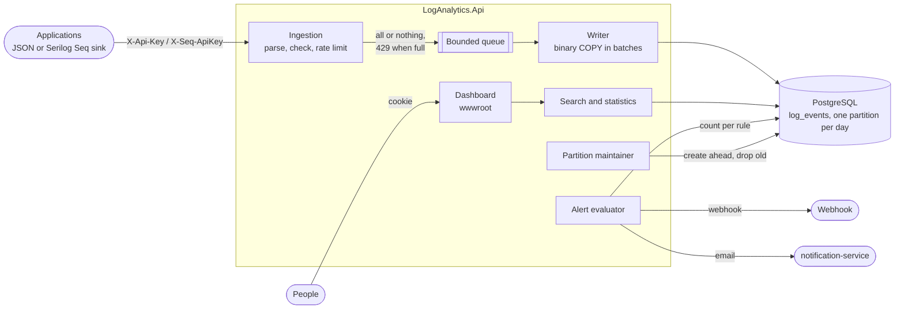
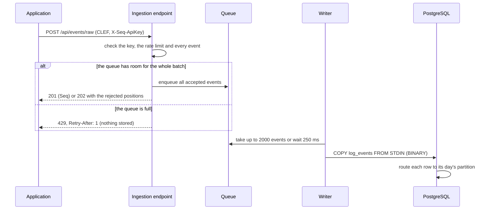

# Log Analytics API

**English** · [Türkçe](README.tr.md)

A log service for other applications. They send structured logs (plain JSON, or unchanged through Serilog's Seq sink), and people search them, see which errors are piling up, follow one request across services and get an alert when errors spike. Everything lives in PostgreSQL, in a table partitioned by day, and a dashboard shows it.

[](https://github.com/Beratoguzhan620/log-analytics-api/actions/workflows/ci.yml)


## Try it

```bash
docker compose up --build
```

This starts PostgreSQL, the API and a **generator** that logs like a small shop's services (checkout, payments, catalog, shipping, notifications) through the ordinary `Serilog.Sinks.Seq` package: a day of history first, then live traffic with error bursts.

- Dashboard: http://localhost:8080. Sign in as `admin@example.com` / `admin-password-local` (local defaults; change them in `.env`).
- API reference: http://localhost:8080/scalar

Sending logs from your own application is one source key away. Add a source on the *Sources* page (the key is shown once), then either post JSON:

```bash
curl -X POST http://localhost:8080/api/events \
  -H "X-Api-Key: la_xxxxxxxx_..." \
  -H "Content-Type: application/json" \
  -d '[{
        "timestamp": "2026-10-30T09:15:00Z",
        "level": "Error",
        "messageTemplate": "Order {OrderId} failed: the payment could not be completed",
        "service": "checkout",
        "traceId": "6eb2cdc89c467473c3f5c9ab2c12643e",
        "properties": { "OrderId": "SIP-1001" }
      }]'
```

or keep using Serilog and only change the URL:

```csharp
Log.Logger = new LoggerConfiguration()
    .WriteTo.Seq("http://localhost:8080", apiKey: "la_xxxxxxxx_...")
    .CreateLogger();
```

## Features

- **Ingestion:** a JSON array or Serilog's compact format (CLEF), up to 1000 events per request. The same endpoint answers at `/api/events/raw` with `X-Seq-ApiKey`, like Seq does, so `Serilog.Sinks.Seq` works unchanged. Events with problems are reported by position while the rest are accepted; very long messages are cut rather than lost.
- **Back-pressure:** accepted events wait in a bounded queue and are written in batches with binary `COPY`. When the queue is full the API answers `429` with `Retry-After` and stores nothing from that request, so a retry never duplicates half a batch. Each source has its own rate limit, so one noisy application cannot crowd out the others.
- **Search:** time range, minimum level, services, full-text search in messages and exceptions (words, `"a phrase"`, `or`, `-exclude`), property equality (`OrderId:SIP-1001`) and trace id; newest first with a cursor.
- **Statistics:** events per time bucket and level (about sixty bars for any window), the most frequent errors grouped by message template, and the error rate of each service.
- **Traces:** every event of one trace id across services, oldest first, with the time since the first one.
- **Alerts:** rules like "at least 20 errors from `payments` within 5 minutes, then quiet for 15". A background evaluator records each firing first and then sends it to a webhook or as an email through the [notification-service](https://github.com/Beratoguzhan620/notification-service), with the firing id as the idempotency key.
- **Retention:** one partition per day; partitions older than 14 days (configurable) are dropped.
- **People and sources:** people sign in with email and password (`Admin` or `Viewer`); applications only hold a source key that can send logs and nothing else.
- **Dashboard:** overview, chart with tooltips, top errors, services, search with expandable events, trace view, alerts and sources. Plain HTML, CSS and JavaScript served by the API, with loading, empty and error states, and usable on a phone.

## Screenshots

| Overview | A bar of the chart |
|---|---|
|  |  |
| **Search with an event opened** | **One order across services** |
|  |  |
| **Alert rules and firings** | **Sources** |
|  |  |
| **Sign-in** | **On a phone** |
|  |  |

## Performance

Measured in CI on a standard GitHub runner by `tests/load/load.sh`: the stack from `docker-compose.yml`, 500,000 events sent by four concurrent clients in batches of 1000.

| Ingestion | |
|---|---|
| Accepted by the API | 30,294 events/s (p50 15.7 ms, p95 56.6 ms per request of 1000 events) |
| Stored, end to end | 22,213 events/s (500,000 events in 22.5 s) |
| Requests told to retry (`429`) | 52 of 500, all stored after retrying |

Query times afterwards, with 565,601 events in the table (427 MB including indexes):

| Query | Time |
|---|---|
| Overview, 24 hours | 89 ms |
| Volume chart, 24 hours | 158 ms |
| Volume chart, 7 days | 162 ms |
| Top errors, 24 hours | 32 ms |
| Search, newest 50, 24 hours | 5 ms |
| Full-text "failed", errors only, 24 hours | 27 ms |
| Property `OrderId=…`, 24 hours | 3 ms |
| One trace | 12 ms |

## Tech stack

- ASP.NET Core 10 minimal APIs, ProblemDetails, OpenAPI with Scalar, rate limiting, cookie authentication
- PostgreSQL 17: declarative partitioning by day, `jsonb` with a GIN index, a generated `tsvector` with a GIN index, `date_bin`, binary `COPY` through Npgsql
- Entity Framework Core 10 for the small tables and migrations; plain SQL for the logs
- A queue on `System.Threading.Channels` with a counted capacity, and a background writer
- Serilog, and `Serilog.Sinks.Seq` in the generator
- Dashboard: HTML, CSS and JavaScript modules with no build step, an SVG chart, IBM Plex and Lucide icons
- xUnit, Testcontainers (real PostgreSQL), WebApplicationFactory, Playwright
- GitHub Actions: warnings as errors, tests, pending-migration check, Compose smoke test, the dashboard flow in a browser, the load test
- Docker / Docker Compose

## Architecture



The life of a batch:



## Design decisions

- **PostgreSQL rather than OpenSearch.** One database to run and back up. At this scale daily partitions, a GIN index on a generated `tsvector` and on the `jsonb` properties, and `date_bin` answer every dashboard query in well under 200 ms, and the numbers above are measured on every change rather than assumed.
- **One partition per day.** Queries are almost always "the last hour" or "the last day", and each one is bounded by time, so PostgreSQL opens only the partitions that can match. Retention drops a whole partition, which is a catalog change: no `DELETE`, no dead rows, no long vacuum. Partitions are created ahead of time for the next days, under an advisory lock so two instances never race.
- **The logs table is plain SQL.** EF Core cannot model a partitioned table. It manages the small tables (users, sources, alert rules) and their migrations; `log_events` is created by a migration in SQL, written with binary `COPY` and read with hand-written queries where every filter is a parameter.
- **A bounded queue between HTTP and the database.** Requests return as soon as their events are checked and queued; a single writer turns them into large `COPY` batches. Memory use is capped by the queue size. A batch goes in whole or not at all, and a full queue answers `429` with `Retry-After`, so a client that retries never stores half a batch twice and nothing is dropped silently. On shutdown the writer drains the queue first.
- **Seq-compatible ingestion.** Real applications send logs without new code: `Serilog.Sinks.Seq` posts CLEF to `/api/events/raw` with `X-Seq-ApiKey`, and this service answers exactly like Seq. The sample generator works this way too, so the dashboard has something real to show from the first minute.
- **Keys send, people read.** A source key can only send logs; reading needs a signed-in person. A leaked key from an application cannot be used to read everyone's logs. Keys are random, stored as SHA-256 hashes and shown once; passwords use PBKDF2, and a login for an unknown email takes as long as a wrong password.
- **Errors are grouped by message template.** `Order SIP-1 failed` and `Order SIP-2 failed` come from the same template, so they count as one kind of error. Events without a template fall back to their message.
- **An alert is saved before it is sent.** The firing is recorded first, then delivered; a slow or failing webhook never loses it, and the firing shows whether it got through. The notification-service gets the firing id as its idempotency key, so a retry after a timeout never sends a second email. A cooldown makes one incident one alert.
- **The dashboard renders logs as text.** Logs contain whatever applications wrote. Nothing is inserted as HTML, and the page has a strict content security policy (scripts, fonts and requests only to its own origin, no framing) as a second line of defence. The session cookie is `HttpOnly` and `SameSite=Strict`, and the API accepts JSON bodies only, so another site cannot act on a signed-in person's behalf.
- **No front-end build.** The dashboard is a few JavaScript modules and one stylesheet served by the API. There is nothing to compile or keep in sync, and the Playwright flow tests what is actually served.

## Commands

| Command | What it does |
|---|---|
| `docker compose up --build` | PostgreSQL, the API and dashboard on http://localhost:8080, and the sample generator |
| `tests/load/load.sh` | Sends 500,000 events to a running stack and times the dashboard's queries (`TOTAL=1000000` for more) |
| `cd tests/e2e && npm install && node dashboard.mjs` | The dashboard flow in a browser against a running stack |
| `dotnet test` | Unit and integration tests (Docker needed for Testcontainers) |
| `dotnet run --project src/LogAnalytics.Api` | Run the API locally (configuration below) |
| `dotnet ef migrations add <Name> --project src/LogAnalytics.Infrastructure --startup-project src/LogAnalytics.Api --output-dir Persistence/Migrations` | Add a migration |

Configuration for a local run, kept out of the repository:

```bash
dotnet user-secrets --project src/LogAnalytics.Api set "ConnectionStrings:Logs" "Host=localhost;Database=log_analytics;Username=…;Password=…"
dotnet user-secrets --project src/LogAnalytics.Api set "Bootstrap:AdminEmail" "you@example.com"
dotnet user-secrets --project src/LogAnalytics.Api set "Bootstrap:AdminPassword" "<at least 12 characters>"
```

To send alert emails through the notification-service, set `Alerts:NotificationService:BaseUrl`, `ApiKey`, `Email` and `Template` (a template with `{{alert}}`, `{{service}}`, `{{count}}`, `{{minutes}}` and `{{sample}}`). Retention is `Retention:Days`; ingestion limits are under `Ingestion`.

## Tests

108 tests: 66 unit tests and 42 integration tests that run the real API against PostgreSQL in Testcontainers, plus a 15-step browser flow and the load test against the Compose stack in CI.

- **Ingestion:** JSON, CLEF and Seq clients; levels by Serilog and Microsoft names; message templates rendered; events outside the kept window, oversized fields and malformed lines rejected by position while the rest are stored; rows land in their day's partition.
- **Back-pressure:** a full queue answers `429` with `Retry-After` and stores nothing from that request; a batch goes in whole or not at all; one source that sends too often is slowed down while the others are not; ten thousand events in ten requests are all written.
- **Search and statistics:** filters by level, service, text, property and trace id; cursor paging without gaps or repeats and a tampered cursor caught; bad queries naming every mistake at once; volume buckets, top errors grouped by template, error rate per service, traces.
- **Alerts:** thresholds, windows and cooldowns; a firing is recorded and sent to a webhook (a recording handler in the tests) or to the notification-service with its idempotency key; a failed delivery is kept with its reason.
- **Retention:** startup creates a partition for every day in the window, days that fall out of it are dropped, and running maintenance twice changes nothing.
- **Access:** source keys cannot read, viewers cannot manage, a revoked key stops working, a wrong email and a wrong password get the same answer, guessing passwords is slowed down, and the session cookie is `HttpOnly` and `SameSite=Strict`.
- **Dashboard (CI):** sign-in, the chart's tooltip, the time range, a top error leading to its events, an event with its exception and properties, its trace, a search with no results, adding an alert rule and a source, the phone layout, and no script errors along the way.

## Roadmap and known gaps

- Kuryo will send its logs here, and the alert email template will be added to the notification-service's samples.
- Live tail over server-sent events.
- Saved searches and alert rules on any search, not only level and service.
- Search across more than the kept window is not possible by design; long-term archives would go to object storage.
- A second storage engine (ClickHouse or OpenSearch) behind the same query code, if the volume ever needs it.

## License

[MIT](LICENSE) · Berat Oğuzhan Turğut · [GitHub](https://github.com/Beratoguzhan620)
