# Log Analytics API

[English](README.md) · **Türkçe**

Diğer uygulamalar için bir log servisi. Uygulamalar yapılandırılmış loglarını gönderir (düz JSON olarak ya da hiçbir şey değiştirmeden Serilog'un Seq sink'iyle). Kullanıcılar bu logları arar, hangi hataların biriktiğini görür, tek bir isteği servisler arasında takip eder ve hatalar ani artış gösterdiğinde alarm alır. Her şey PostgreSQL'de, güne göre bölümlenmiş (partitioned) bir tabloda duruyor; bir pano da bunları gösteriyor.

[](https://github.com/Beratoguzhan620/log-analytics-api/actions/workflows/ci.yml)


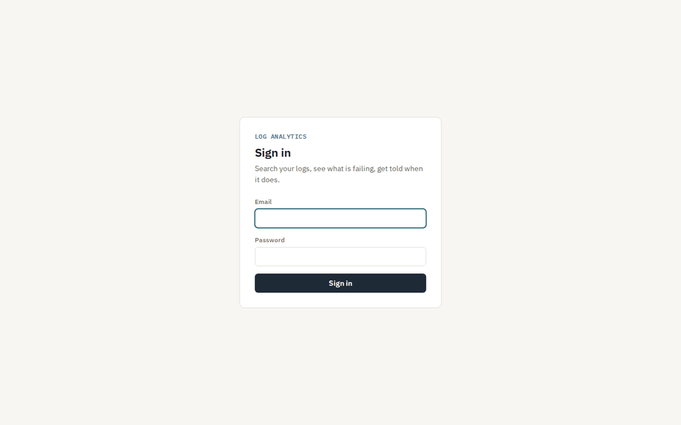

## Deneme

```bash
docker compose up --build
```

Bu komut PostgreSQL'i, API'yi ve bir **üreteci** (generator) başlatır. Üreteç, küçük bir mağazanın servisleri (checkout, payments, catalog, shipping, notifications) gibi, sıradan `Serilog.Sinks.Seq` paketiyle log yazar: önce bir günlük geçmiş, ardından ara ara hata patlamaları olan canlı trafik.

- Pano: http://localhost:8080. `admin@example.com` / `admin-password-local` ile giriş yap (yerel varsayılanlar; `.env` dosyasından değiştirebilirsin).
- API belgesi: http://localhost:8080/scalar

Kendi uygulamandan log göndermek için tek gereken bir kaynak anahtarı. *Sources* sayfasından bir kaynak ekle (anahtar yalnızca bir kez gösterilir), sonra ya JSON gönder:

```bash
curl -X POST http://localhost:8080/api/events \
  -H "X-Api-Key: la_xxxxxxxx_..." \
  -H "Content-Type: application/json" \
  -d '[{
        "timestamp": "2026-10-30T09:15:00Z",
        "level": "Error",
        "messageTemplate": "Order {OrderId} failed: the payment could not be completed",
        "service": "checkout",
        "traceId": "6eb2cdc89c467473c3f5c9ab2c12643e",
        "properties": { "OrderId": "SIP-1001" }
      }]'
```

ya da Serilog kullanmaya devam et ve yalnızca adresi değiştir:

```csharp
Log.Logger = new LoggerConfiguration()
    .WriteTo.Seq("http://localhost:8080", apiKey: "la_xxxxxxxx_...")
    .CreateLogger();
```

## Özellikler

- **Log alma:** JSON dizisi ya da Serilog'un sıkıştırılmış biçimi (CLEF); istek başına en fazla 1000 olay. Aynı uç nokta, Seq'te olduğu gibi `/api/events/raw` adresinde `X-Seq-ApiKey` ile de cevap verir; böylece `Serilog.Sinks.Seq` hiç değişmeden çalışır. Sorunlu olaylar sıra numaralarıyla bildirilir, geri kalanlar kabul edilir; çok uzun mesajlar kaybolmaz, kısaltılır.
- **Geri basınç (back-pressure):** kabul edilen olaylar sınırlı bir kuyrukta bekler ve ikili (binary) `COPY` ile toplu yazılır. Kuyruk doluysa API `Retry-After` ile `429` döner ve o istekten hiçbir şey saklamaz; böylece tekrar deneyen istemci bir grubun yarısını iki kez yazmış olmaz. Her kaynağın kendi hız sınırı var; gürültülü bir uygulama diğerlerinin önünü kesemez.
- **Arama:** zaman aralığı, en düşük seviye, servisler, mesaj ve istisnalarda tam metin arama (kelimeler, `"bir ifade"`, `or`, `-hariç`), property eşitliği (`OrderId:SIP-1001`) ve trace id; en yeni önce, cursor ile sayfalama.
- **İstatistikler:** zaman dilimi ve seviye başına olay sayısı (her aralık için yaklaşık altmış çubuk), mesaj şablonuna göre gruplanmış en sık hatalar ve her servisin hata oranı.
- **İzler (trace):** bir trace id'nin servisler arasındaki bütün olayları, eskiden yeniye, ilk olaydan bu yana geçen süreyle.
- **Alarmlar:** "`payments` servisinden 5 dakika içinde en az 20 hata, ardından 15 dakika sessizlik" gibi kurallar. Arka planda çalışan değerlendirici her tetiklenmeyi önce kaydeder, sonra bir webhook'a ya da [notification-service](https://github.com/Beratoguzhan620/notification-service) üzerinden e-posta olarak gönderir; idempotency anahtarı tetiklenmenin id'sidir.
- **Saklama süresi:** her güne bir bölüm; 14 günden (ayarlanabilir) eski bölümler düşürülür.
- **Kişiler ve kaynaklar:** kişiler e-posta ve parolayla giriş yapar (`Admin` ya da `Viewer`); uygulamaların elinde yalnızca log gönderebilen, başka hiçbir şey yapamayan bir kaynak anahtarı vardır.
- **Pano:** genel bakış, ipuçlu grafik, en sık hatalar, servisler, açılabilir olaylarla arama, iz görünümü, alarmlar ve kaynaklar. API'nin sunduğu düz HTML, CSS ve JavaScript; yükleniyor, boş ve hata durumları var, telefonda da kullanılabiliyor.

## Ekran görüntüleri

| Genel bakış | Grafikteki bir çubuk |
|---|---|
| 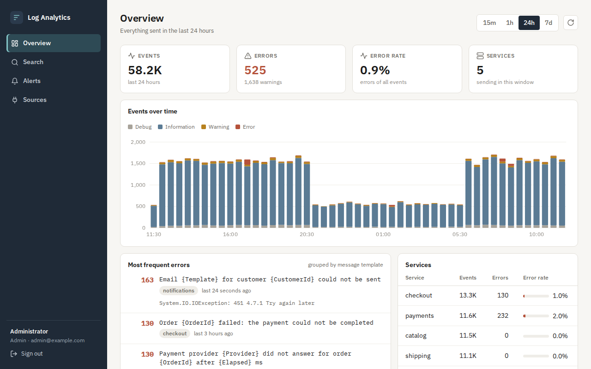 | 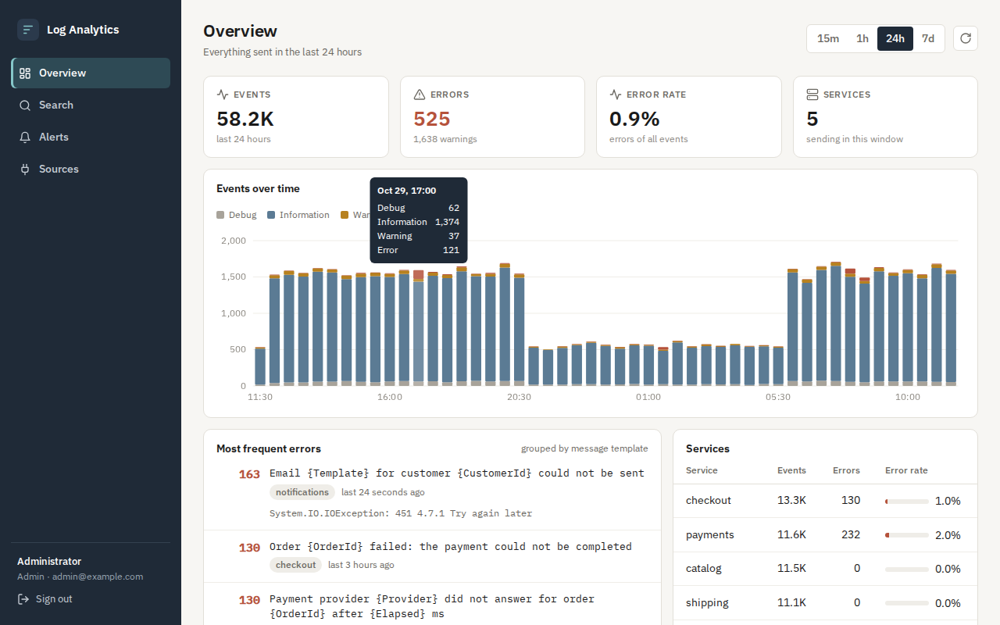 |
| **Açılmış bir olayla arama** | **Bir siparişin servisler arasındaki yolu** |
| 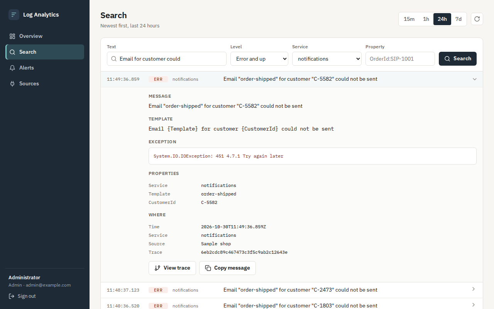 | 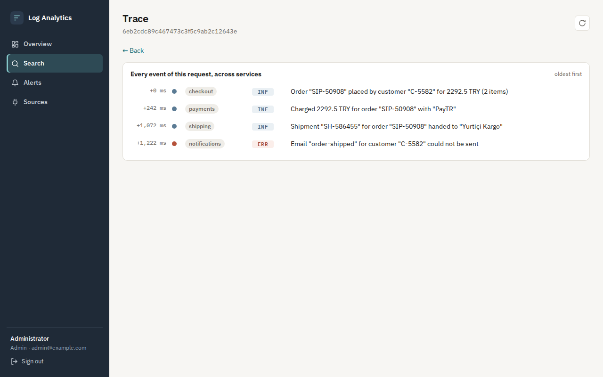 |
| **Alarm kuralları ve tetiklenmeler** | **Kaynaklar** |
| 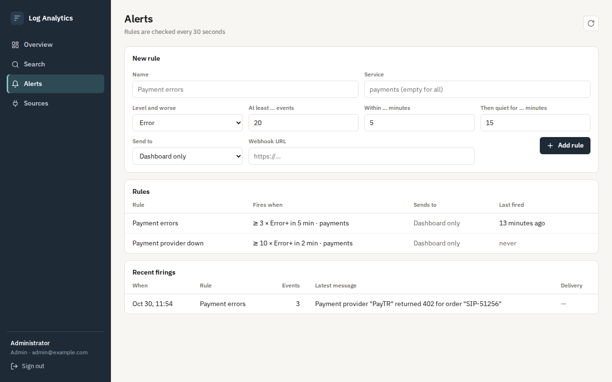 | 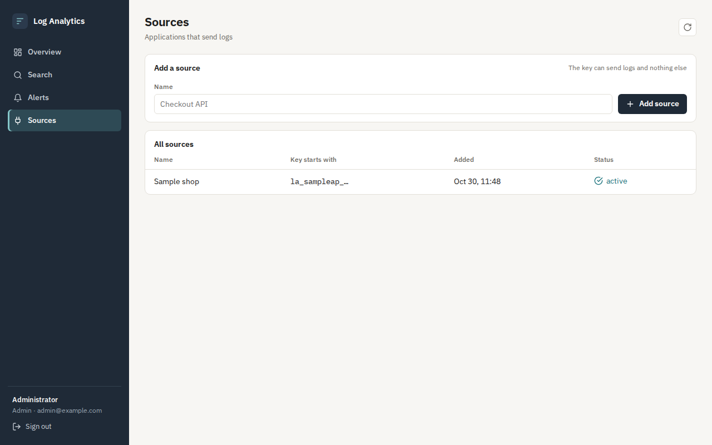 |
| **Giriş** | **Telefonda** |
| 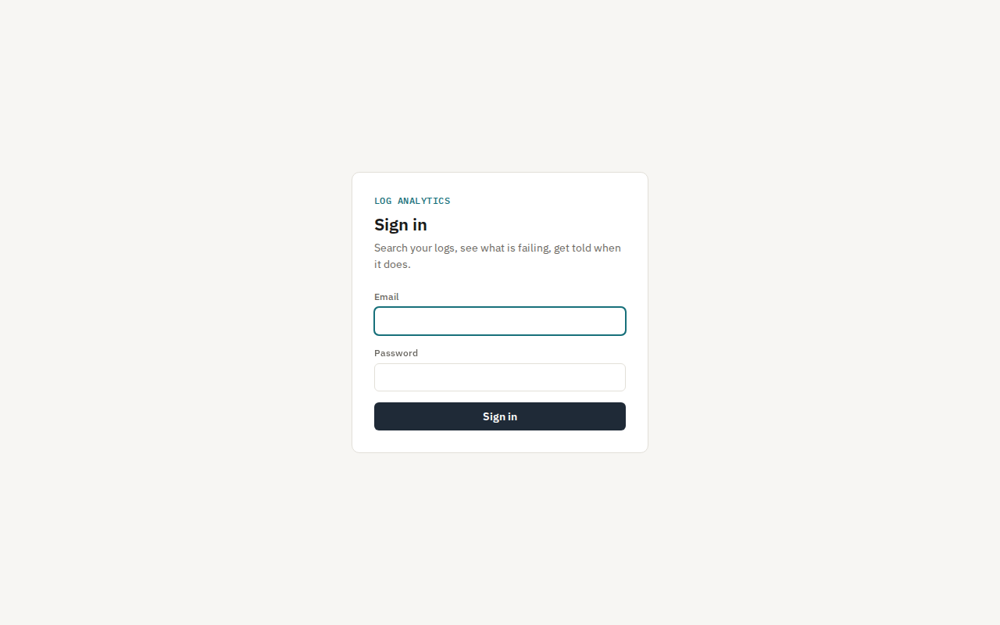 | 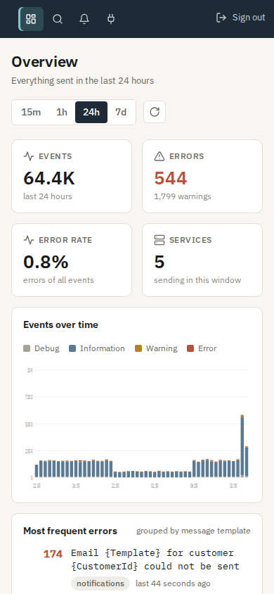 |

## Performans

CI'da, standart bir GitHub runner'ında `tests/load/load.sh` ile ölçüldü: `docker-compose.yml`'deki kurulum, aynı anda çalışan dört istemcinin 1000'lik gruplar halinde gönderdiği 500.000 olay.

| Log alma | |
|---|---|
| API'nin kabul ettiği | saniyede 30.294 olay (1000 olaylık istek başına p50 15,7 ms, p95 56,6 ms) |
| Uçtan uca yazılan | saniyede 22.213 olay (500.000 olay 22,5 saniyede) |
| Tekrar denemesi istenen (`429`) | 500 istekten 52'si; tekrar denendikten sonra hepsi yazıldı |

Ardından, tabloda 565.601 olay varken (indekslerle birlikte 427 MB) sorgu süreleri:

| Sorgu | Süre |
|---|---|
| Genel bakış, 24 saat | 89 ms |
| Hacim grafiği, 24 saat | 158 ms |
| Hacim grafiği, 7 gün | 162 ms |
| En sık hatalar, 24 saat | 32 ms |
| Arama, en yeni 50, 24 saat | 5 ms |
| Tam metin "failed", yalnızca hatalar, 24 saat | 27 ms |
| Property `OrderId=…`, 24 saat | 3 ms |
| Tek bir iz | 12 ms |

## Teknolojiler

- ASP.NET Core 10 minimal API, ProblemDetails, Scalar ile OpenAPI, hız sınırlama, çerezle kimlik doğrulama
- PostgreSQL 17: güne göre bildirimsel bölümleme, GIN indeksli `jsonb`, GIN indeksli üretilmiş (generated) `tsvector` sütunu, `date_bin`, Npgsql ile ikili `COPY`
- Küçük tablolar ve migration'lar için Entity Framework Core 10; loglar için düz SQL
- `System.Threading.Channels` üzerinde sayılan kapasiteli bir kuyruk ve arka planda bir yazıcı
- Serilog; üreteçte `Serilog.Sinks.Seq`
- Pano: derleme adımı olmayan HTML, CSS ve JavaScript modülleri, SVG grafik, IBM Plex ve Lucide ikonları
- xUnit, Testcontainers (gerçek PostgreSQL), WebApplicationFactory, Playwright
- GitHub Actions: uyarılar hata sayılır, testler, bekleyen migration kontrolü, Compose duman testi, tarayıcıda pano akışı, yük testi
- Docker / Docker Compose

## Mimari

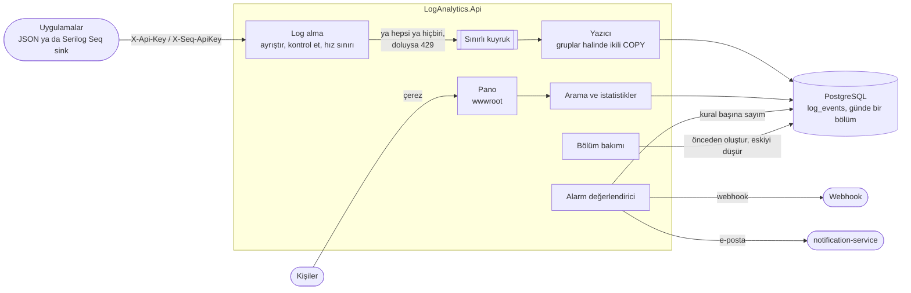

Bir grubun yolculuğu:

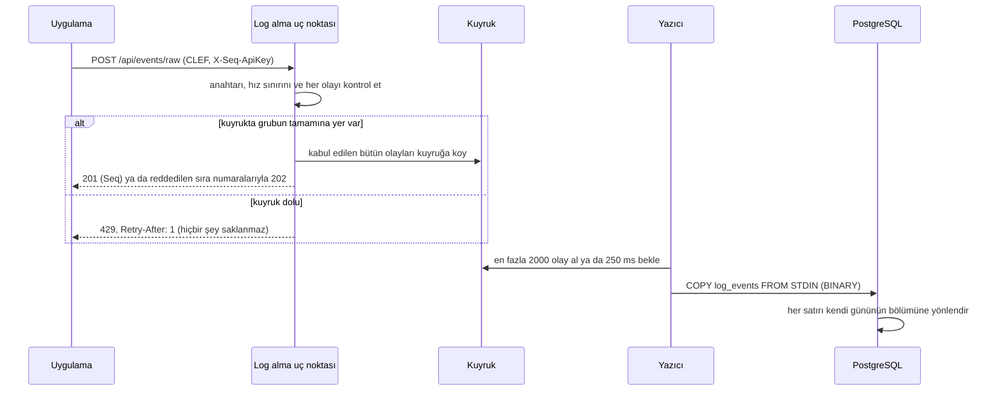

## Tasarım kararları

- **OpenSearch yerine PostgreSQL.** Çalıştırılacak ve yedeklenecek tek bir veritabanı. Bu ölçekte günlük bölümler, üretilmiş `tsvector` ve `jsonb` property'ler üzerindeki GIN indeksleri ve `date_bin`, panonun her sorgusunu 200 ms'nin çok altında cevaplıyor. Yukarıdaki sayılar varsayılmıyor, her değişiklikte ölçülüyor.
- **Günde bir bölüm.** Sorgular neredeyse her zaman "son bir saat" ya da "son bir gün" içindir ve her biri zamanla sınırlıdır; PostgreSQL yalnızca eşleşebilecek bölümleri açar. Saklama süresi bütün bir bölümü düşürür; bu yalnızca bir katalog değişikliğidir: `DELETE` yok, ölü satır yok, uzun vacuum yok. Önümüzdeki günlerin bölümleri önceden oluşturulur; iki örnek aynı anda yarışmasın diye bu iş bir advisory lock altında yapılır.
- **Log tablosu düz SQL.** EF Core bölümlenmiş bir tabloyu modelleyemez. EF küçük tabloları (kullanıcılar, kaynaklar, alarm kuralları) ve migration'larını yönetir; `log_events` bir migration içinde SQL ile oluşturulur, ikili `COPY` ile yazılır ve her filtrenin bir parametre olduğu elle yazılmış sorgularla okunur.
- **HTTP ile veritabanı arasında sınırlı bir kuyruk.** İstekler, olayları kontrol edilip kuyruğa girer girmez döner; tek bir yazıcı bunları büyük `COPY` gruplarına çevirir. Bellek kullanımı kuyruk boyutuyla sınırlıdır. Bir grup ya bütünüyle girer ya hiç girmez; kuyruk doluysa `Retry-After` ile `429` döner. Böylece tekrar deneyen bir istemci bir grubun yarısını iki kez yazmaz ve hiçbir şey sessizce kaybolmaz. Kapanırken yazıcı önce kuyruğu boşaltır.
- **Seq uyumlu log alma.** Gerçek uygulamalar yeni kod yazmadan log gönderebilir: `Serilog.Sinks.Seq`, CLEF'i `X-Seq-ApiKey` ile `/api/events/raw` adresine gönderir ve bu servis Seq'in verdiği cevabın aynısını verir. Örnek üreteç de böyle çalışıyor; pano ilk dakikadan gösterecek gerçek bir şey buluyor.
- **Anahtarlar gönderir, kişiler okur.** Bir kaynak anahtarı yalnızca log gönderebilir; okumak için giriş yapmış bir kişi gerekir. Bir uygulamadan sızan anahtarla herkesin logları okunamaz. Anahtarlar rastgeledir, SHA-256 özeti olarak saklanır ve bir kez gösterilir. Parolalar PBKDF2 ile saklanır; bilinmeyen bir e-postayla giriş denemesi, yanlış parolayla yapılan deneme kadar sürer.
- **Hatalar mesaj şablonuna göre gruplanır.** `Order SIP-1 failed` ile `Order SIP-2 failed` aynı şablondan gelir; tek bir hata türü sayılırlar. Şablonu olmayan olaylarda mesajın kendisi kullanılır.
- **Alarm gönderilmeden önce kaydedilir.** Tetiklenme önce kaydedilir, sonra iletilir; yavaş ya da hata veren bir webhook onu kaybettiremez ve tetiklenme kaydı iletimin başarılı olup olmadığını gösterir. notification-service'e idempotency anahtarı olarak tetiklenmenin id'si gider; zaman aşımından sonraki bir tekrar ikinci bir e-posta göndermez. Bekleme süresi (cooldown) sayesinde bir olay tek bir alarm olur.
- **Pano logları metin olarak gösterir.** Loglarda uygulamalar ne yazdıysa o vardır. Hiçbir şey HTML olarak eklenmez; ikinci savunma hattı olarak sayfanın sıkı bir içerik güvenlik politikası (CSP) var: script, font ve istekler yalnızca kendi kaynağına, çerçeveleme yok. Oturum çerezi `HttpOnly` ve `SameSite=Strict`; API yalnızca JSON gövde kabul ediyor, bu yüzden başka bir site giriş yapmış birinin adına işlem yapamaz.
- **Ön yüzde derleme adımı yok.** Pano, API'nin sunduğu birkaç JavaScript modülü ve bir stil dosyasından oluşuyor. Derlenecek ya da senkron tutulacak bir şey yok; Playwright akışı tam olarak sunulan dosyaları test ediyor.

## Komutlar

| Komut | Ne yapar |
|---|---|
| `docker compose up --build` | PostgreSQL, http://localhost:8080 üzerinde API ve pano, örnek üreteç |
| `tests/load/load.sh` | Çalışan kuruluma 500.000 olay gönderir ve panonun sorgularını ölçer (daha fazlası için `TOTAL=1000000`) |
| `cd tests/e2e && npm install && node dashboard.mjs` | Çalışan kuruluma karşı tarayıcıda pano akışı |
| `dotnet test` | Birim ve entegrasyon testleri (Testcontainers için Docker gerekir) |
| `dotnet run --project src/LogAnalytics.Api` | API'yi yerelde çalıştırır (aşağıdaki ayarlarla) |
| `dotnet ef migrations add <Ad> --project src/LogAnalytics.Infrastructure --startup-project src/LogAnalytics.Api --output-dir Persistence/Migrations` | Migration ekler |

Yerelde çalıştırmak için ayarlar; repoya girmezler:

```bash
dotnet user-secrets --project src/LogAnalytics.Api set "ConnectionStrings:Logs" "Host=localhost;Database=log_analytics;Username=…;Password=…"
dotnet user-secrets --project src/LogAnalytics.Api set "Bootstrap:AdminEmail" "sen@example.com"
dotnet user-secrets --project src/LogAnalytics.Api set "Bootstrap:AdminPassword" "<en az 12 karakter>"
```

Alarm e-postalarını notification-service üzerinden göndermek için `Alerts:NotificationService:BaseUrl`, `ApiKey`, `Email` ve `Template` ayarlarını yap (`{{alert}}`, `{{service}}`, `{{count}}`, `{{minutes}}` ve `{{sample}}` değişkenleri olan bir şablon). Saklama süresi `Retention:Days`; log alma sınırları `Ingestion` altında.

## Testler

108 test: 66 birim testi ve gerçek API'yi Testcontainers'taki PostgreSQL'e karşı çalıştıran 42 entegrasyon testi. Bunlara ek olarak CI'da Compose kurulumuna karşı 15 adımlık bir tarayıcı akışı ve yük testi çalışır.

- **Log alma:** JSON, CLEF ve Seq istemcileri; Serilog ve Microsoft adlarıyla seviyeler; şablonların Serilog gibi doldurulması; saklanan zaman aralığının dışındaki olaylar, fazla büyük alanlar ve bozuk satırlar sıra numarasıyla reddedilirken geri kalanların saklanması; satırların kendi gününün bölümüne düşmesi.
- **Geri basınç:** dolu kuyruk `Retry-After` ile `429` döner ve o istekten hiçbir şey saklamaz; bir grup ya bütünüyle girer ya hiç girmez; çok sık gönderen bir kaynak yavaşlatılır, diğerleri etkilenmez; on istekteki on bin olayın hepsi yazılır.
- **Arama ve istatistikler:** seviye, servis, metin, property ve trace id filtreleri; boşluksuz ve tekrarsız cursor sayfalaması ve değiştirilmiş cursor'ın yakalanması; hatalı sorgularda bütün hataların birlikte sayılması; zaman dilimleri, şablona göre gruplanan hatalar, servis başına hata oranı, izler.
- **Alarmlar:** eşikler, zaman pencereleri ve bekleme süreleri; tetiklenmenin kaydedilip bir webhook'a (testlerde istekleri kaydeden bir handler) ya da idempotency anahtarıyla notification-service'e gönderilmesi; başarısız iletimin nedeniyle saklanması.
- **Saklama süresi:** başlangıçta penceredeki her gün için bölüm oluşturulması, pencereden çıkan günlerin düşürülmesi ve bakımın ikinci kez çalışmasının hiçbir şeyi değiştirmemesi.
- **Erişim:** kaynak anahtarları okuyamaz, viewer'lar yönetemez, iptal edilen anahtar çalışmayı bırakır, yanlış e-posta ile yanlış parola aynı yanıtı alır, parola tahmini yavaşlatılır, oturum çerezi `HttpOnly` ve `SameSite=Strict`.
- **Pano (CI):** giriş, grafiğin ipucu, zaman aralığı, en sık bir hatadan olaylarına gitmek, istisnası ve property'leriyle bir olay, izi, sonuç bulunmayan bir arama, alarm kuralı ve kaynak eklemek, telefon görünümü ve yol boyunca hiç script hatası olmaması.

## Yol haritası ve bilinen eksikler

- Kuryo loglarını buraya gönderecek; alarm e-postası şablonu notification-service'in örnek şablonlarına eklenecek.
- Server-sent events ile canlı log akışı.
- Kayıtlı aramalar ve yalnızca seviye ile servise değil, herhangi bir aramaya bağlı alarm kuralları.
- Saklama süresinin dışında arama tasarım gereği yok; uzun süreli arşiv nesne depolamaya gider.
- Hacim gerektirirse aynı sorgu kodunun arkasında ikinci bir depolama motoru (ClickHouse ya da OpenSearch).

## Lisans

[MIT](LICENSE) · Berat Oğuzhan Turğut · [GitHub](https://github.com/Beratoguzhan620)
